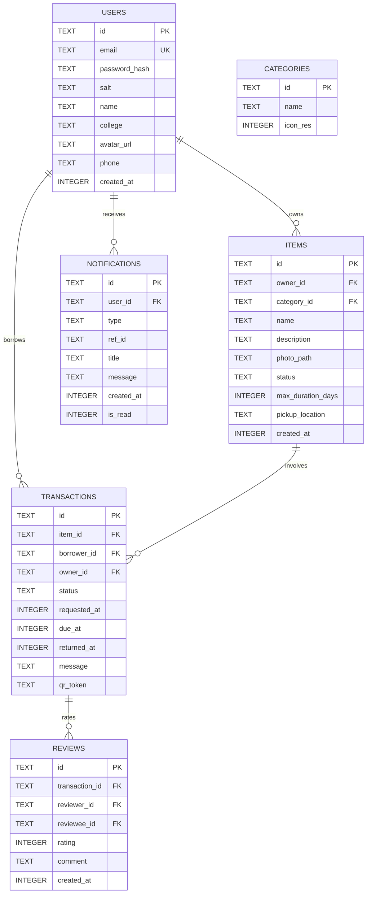

# BorrowBox Android Application (Java and XML)

BorrowBox is a native student peer-to-peer item borrowing and campus sharing platform built for Android using Java, XML layouts, and Material 3 design system (minSdk 24, compileSdk 34).

---

## Architecture and Database Design

The app implements clean repository architecture separating the presentation layer from persistence. All database operations run asynchronously on a background thread pool (`AppExecutors`) and post UI updates back to the Android main thread.

### Database Schema (SQLite v2)



### Important Notice: On-Device Storage and Remote Backend Integration

> **Note on Persistence and Campus Sharing:**
> All data in BorrowBox is currently stored on-device using a normalized SQLite database with foreign keys and PBKDF2 password security.
>
> To share items live across multiple independent student devices, a remote backend (Firebase Firestore, Supabase, or a REST API) is required.
> Because the codebase is strictly decoupled through repository abstractions (`UserRepository`, `ItemRepository`, `BorrowRepository`, `NotificationRepository`, `ReviewRepository`), a remote backend can be connected by simply replacing or wrapping SQLite calls in each repository with remote network/WebSocket calls without touching any UI Fragment or Activity code.

---

## Security Hardening and Production Readiness

1. **Password Hashing:** Passwords are never stored in plain text. Stored passwords use `PBKDF2WithHmacSHA256` with 10,000 iterations and a cryptographically secure 16-byte random salt per user.
2. **Database Integrity:** Incremental migrations preserve user data across version upgrades; `PRAGMA foreign_keys = ON` enforces relational consistency.
3. **Backup Protection:** `allowBackup="false"` and `data_extraction_rules.xml` ensure SQLite database files and session credentials are never leaked via ADB backups or cloud transfers.
4. **Network Security:** `usesCleartextTraffic="false"` prevents unencrypted HTTP transmissions.
5. **Release Shrinking:** ProGuard and R8 rules (`minifyEnabled true`, `shrinkResources true`) are configured with keep rules for Glide, CameraX, ZXing, and ML Kit Barcode Scanning.

---

## Hardware Integration: Camera and QR Verification

- **CameraX Capture:** Add Item photo listing (up to 3 photos with thumbnail previews) and Profile avatar selection use real CameraX capture (`CameraCaptureActivity`) with front/back lens switching, flash toggle, downscaling (max 1280px, 80% JPEG compression), and gallery fallback.
- **QR Handover Verification:** Physical handovers are verified in-person using ZXing QR generation and ML Kit Barcode Scanning (`ScanQrActivity`). A transaction transitions to `borrowed` only when the owner scans the borrower's cryptographic handover QR token.

---

## Project Structure

```text
app/src/main/
├── AndroidManifest.xml
├── java/com/borrowbox/app/
│   ├── BorrowBoxApplication.java
│   ├── adapters/
│   │   ├── CategoryAdapter.java
│   │   ├── DueItemAdapter.java
│   │   ├── HistoryAdapter.java
│   │   ├── ItemGridAdapter.java
│   │   ├── MyItemAdapter.java
│   │   ├── NotificationAdapter.java
│   │   ├── OnboardingPagerAdapter.java
│   │   ├── PendingRequestAdapter.java
│   │   ├── SearchResultAdapter.java
│   │   └── TransactionAdapter.java
│   ├── data/
│   │   ├── DatabaseHelper.java
│   │   ├── DataManager.java
│   │   ├── SessionManager.java
│   │   └── repository/
│   │       ├── BorrowRepository.java
│   │       ├── ItemRepository.java
│   │       ├── NotificationRepository.java
│   │       ├── RepositoryCallback.java
│   │       ├── ReviewRepository.java
│   │       └── UserRepository.java
│   ├── models/
│   │   ├── Category.java
│   │   ├── Item.java
│   │   ├── NotificationItem.java
│   │   ├── Review.java
│   │   ├── Transaction.java
│   │   └── User.java
│   ├── ui/
│   │   ├── activities/
│   │   │   ├── BorrowRequestActivity.java
│   │   │   ├── CameraCaptureActivity.java
│   │   │   ├── HistoryActivity.java
│   │   │   ├── ItemDetailsActivity.java
│   │   │   ├── LoginActivity.java
│   │   │   ├── MainActivity.java
│   │   │   ├── MyItemsActivity.java
│   │   │   ├── NotificationsActivity.java
│   │   │   ├── OnboardingActivity.java
│   │   │   ├── QRVerificationActivity.java
│   │   │   ├── RatingActivity.java
│   │   │   ├── ScanQrActivity.java
│   │   │   ├── SearchActivity.java
│   │   │   ├── SignupActivity.java
│   │   │   └── SplashActivity.java
│   │   ├── fragments/
│   │   │   ├── ActivityFragment.java
│   │   │   ├── AddItemFragment.java
│   │   │   ├── ExploreFragment.java
│   │   │   ├── HomeFragment.java
│   │   │   └── ProfileFragment.java
│   │   └── viewmodels/
│   │       └── AddItemViewModel.java
│   └── utils/
│       ├── AppExecutors.java
│       ├── AvatarDrawable.java
│       ├── DateTimeUtils.java
│       ├── ImageUtils.java
│       ├── PasswordHasher.java
│       └── QrUtils.java
└── res/
    ├── drawable/
    ├── layout/
    ├── values/
    ├── values-night/
    └── xml/
```

---

## Build and Testing Instructions

### Prerequisites
- JDK 17, 21, or 25 installed
- Android SDK with Platform 34 and Build-Tools installed

### Build Debug APK
```bash
./gradlew assembleDebug
```

### Run Unit Tests
```bash
./gradlew testDebugUnitTest
```

### Run Lint Checks
```bash
./gradlew lintDebug
```
